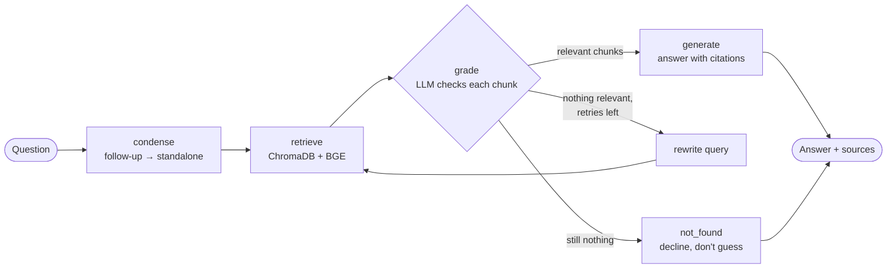

# DocPilot: Agentic RAG over your documents

DocPilot answers questions **only from your own documents** (PDF, Markdown, text), cites its sources, remembers the conversation, and **declines instead of guessing** when the answer isn't there.

It's a **corrective RAG agent built with LangGraph**. It doesn't just retrieve and answer: it checks whether what it retrieved is actually relevant, rewrites the search if it isn't, and only then answers.

**Stack:** LangGraph · LangChain · ChromaDB · BGE embeddings (Hugging Face) · OpenAI GPT **or** LLaMA via Ollama · FastAPI (SSE streaming) · React + TypeScript · Docker · GitHub Actions

---

## How the agent works



| Node | What it does |
|---|---|
| `condense` | Uses chat memory to turn “and for interns?” into a standalone question |
| `retrieve` | Cosine search over BGE embeddings in ChromaDB (top-k) |
| `grade` | The LLM grades every chunk for relevance (in parallel) and drops noise |
| `rewrite` | If nothing passed, the LLM rewrites the query with better keywords (max 2 tries) |
| `generate` | Answers strictly from the graded chunks, citing each claim as `[n]` |
| `not_found` | Returns a clear “not in your documents” answer instead of hallucinating |

Conversation memory is stored per `thread_id` with a LangGraph checkpointer.

## Features

- **Swappable LLMs:** `LLM_PROVIDER=openai` (GPT via the OpenAI SDK), `groq` (LLaMA hosted on Groq) or `ollama` (LLaMA running locally). No code changes.
- **Local embeddings:** `BAAI/bge-small-en-v1.5` by default, with the BGE query instruction applied correctly. You can switch to `thenlper/gte-large` or `bge-large` with one env var.
- **Duplicate-safe ingestion:** chunk IDs are content hashes, and re-uploading a file replaces its old chunks.
- **Streaming API:** Server-Sent Events stream the agent's steps live, then the answer tokens.
- **Explainable UI:** each answer shows the agent trace (retrieved → graded → rewritten → answered) and clickable citations that open the exact source chunk.
- **Offline test mode:** a fake LLM and hashing embeddings let tests and evaluation run in CI with no API key or model download.
- **Built-in evaluation:** hit@k, MRR, answer accuracy and citation accuracy on a labelled question set.

## Quick start

### 1. Backend
```bash
cd backend
python -m venv .venv && source .venv/bin/activate
pip install -r requirements-dev.txt
cp .env.example .env            # add your OPENAI_API_KEY, or set LLM_PROVIDER=ollama

python -m app.ingest data/sample_docs     # index the sample policies
uvicorn app.main:app --reload             # http://localhost:8000/docs
```

To run fully local with LLaMA:
```bash
ollama pull llama3.1
LLM_PROVIDER=ollama uvicorn app.main:app --reload
```

### 2. Frontend
```bash
cd frontend
npm install
npm run dev                     # http://localhost:5173 (proxies /api to :8000)
```

### Or with Docker
```bash
docker compose up --build                                        # OpenAI
LLM_PROVIDER=ollama docker compose --profile local up --build    # fully local with Ollama
```
Then open http://localhost:8000. The API serves the built UI.

## Deploying to Hugging Face Spaces

1. Create a Space (SDK: **Docker**, hardware: free CPU).
2. In the Space's **Settings → Variables and secrets**, add `LLM_PROVIDER=groq` and a `GROQ_API_KEY` secret (or `LLM_PROVIDER=openai` with `OPENAI_API_KEY`). Optionally set `ALLOW_UPLOADS=false` for a read-only public demo.
3. In this GitHub repo, add an `HF_TOKEN` secret (a Hugging Face write token) and an `HF_SPACE` variable (e.g. `your-username/docpilot`). Every push to `main` then deploys automatically through `.github/workflows/deploy-hf.yml`.

The sample policies are indexed automatically on first start.

## API

| Method | Endpoint | Description |
|---|---|---|
| `POST` | `/api/documents` | Upload `.pdf/.md/.txt` files (multipart) |
| `GET` | `/api/documents` | List indexed documents and chunk counts |
| `DELETE` | `/api/documents/{source}` | Remove a document |
| `POST` | `/api/chat` | `{question, thread_id?}` → `{answer, citations, steps, thread_id}` |
| `POST` | `/api/chat/stream` | Same, as SSE events: `thread`, `step`, `token`, `done` |
| `GET` | `/api/health` | Active LLM and embedding model |

## Tests and evaluation

```bash
cd backend
pytest -q                                   # 12 offline tests: ingestion, retrieval, agent routing, memory, API, streaming
python -m eval.run_eval                     # hit@k, MRR, answer + citation accuracy
python -m eval.run_eval --no-agent          # retrieval-only metrics
```

Offline baseline on the sample set (hashing embeddings + rule-based fake LLM, run in CI):

| Metric | Score |
|---|---|
| hit@5 | 100% |
| MRR | 1.00 |
| Answer accuracy | 92% |
| Citation accuracy | 100% |

Run the same script with `LLM_PROVIDER=openai EMBEDDINGS_PROVIDER=hf` to measure the real models.

## Project structure

```
backend/
  app/
    config.py        settings (env-driven)
    providers.py     LLM + embedding factories (OpenAI / Ollama / BGE / fakes)
    vectorstore.py   ChromaDB wrapper (cosine), search, list, delete
    ingest.py        load → split → embed → upsert (CLI too)
    prompts.py       all prompts in one place
    graph.py         LangGraph agent: condense → retrieve → grade → rewrite/generate/not_found
    main.py          FastAPI app + SSE streaming
    fakes.py         offline LLM + embeddings for tests/CI
  eval/              labelled dataset + metrics script
  tests/             pytest suite
  data/sample_docs/  demo policies (fictional company)
frontend/            React + TypeScript (Vite) chat UI
Dockerfile, docker-compose.yml, .github/workflows/ci.yml
```

## Design decisions

- **Why grade chunks?** Plain RAG passes whatever the vector search returns to the LLM, including irrelevant chunks, which leads to confident wrong answers. Grading filters them out, and the rewrite loop recovers when the user's wording doesn't match the documents.
- **Why LangGraph rather than a single chain?** The flow has loops (rewrite → retrieve) and branches (answer vs decline). A state graph makes those explicit, testable (`route_after_grade` is unit-tested) and easy to extend.
- **Why BGE?** It's a strong open-source embedding model that runs on CPU, so documents never leave the machine. Queries get the BGE instruction prefix and documents don't, as the model was trained.
- **Why cosine in Chroma?** BGE/GTE vectors are normalised, so cosine is the right metric, and the API reports scores as similarity (0–1).

## Roadmap

- Hybrid search (BM25 + vectors) with a cross-encoder re-ranker (e.g. `bge-reranker`)
- LLM-as-judge faithfulness scoring in the eval
- Databricks Mosaic AI Vector Search as an alternative vector store
- Auth and per-user collections
