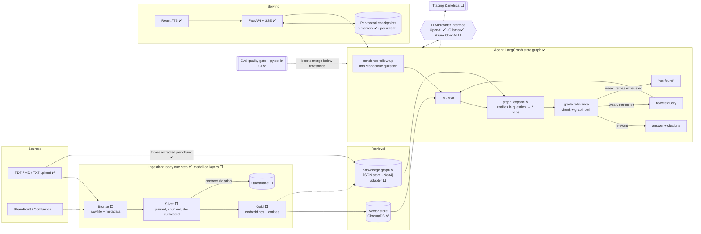
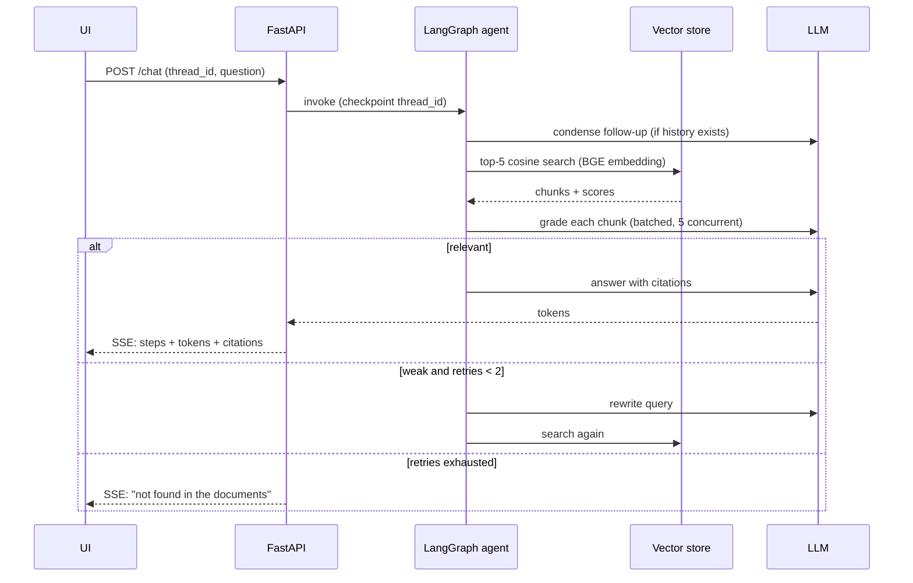

# DocPilot — Architecture

> **Corrective agentic RAG over technical documents: it answers with citations, or says "not found".**
> Designed as governed, swappable building blocks so the same blueprint scales from a laptop PoC to an enterprise platform.

**Status legend:** ✅ built · 🟡 in progress · ⬜ planned
Status and numbers checked against the code and a local eval run on 2026-11-17. Targets are labelled as targets.

---

## 0. TL;DR for reviewers

| Question | Answer |
|---|---|
| What problem? | Engineers waste time searching manuals, specs and reports; naive chatbots answer confidently from the wrong page. |
| Core idea | Grade retrieved context before answering; rewrite the query if it's weak; refuse if it's still weak. |
| Key quality attribute | **Trustworthiness over fluency**: every answer is traceable to a source chunk, or it is not given. |
| How is quality enforced? | An eval harness (hit@5, MRR, answer and citation accuracy) and 12 offline pytest tests run in GitHub Actions; the eval is a quality gate that fails the build below thresholds. |
| How does it scale? | Interfaces around the LLM and the vector store today; medallion ingestion and an Azure target are designed (§6, §8). |
| What's next? | Medallion ingestion with a data contract (ADR-002), harder eval set, Neo4j adapter for the graph (ADR-004), Azure (ADR-005). |

---

## 1. Context & goals

**Users:** engineers and analysts asking questions over large document sets (manuals, inspection reports, standards).

**Goals**
1. Grounded answers with page-level citations.
2. An explicit "not found" instead of a hallucinated answer.
3. Vendor-neutral: switch LLM or vector store by config.
4. Measurable: every change is evaluated before merge.

**Non-goals (for now)**
- Real-time streaming ingestion (batch is enough for documents).
- Fine-tuning a domain LLM (retrieval quality is the bottleneck, not model knowledge).
- Write-back actions (read-only assistant; no agent side effects).

---

## 2. Quality attributes (what the architecture optimises for)

| Attribute | Target | Mechanism |
|---|---|---|
| Faithfulness | Citation accuracy ≥ 95% on the eval set | Relevance grading, citation-required prompt, refusal path |
| Retrieval quality | hit@5 ≥ 90%, MRR ≥ 0.80 on a non-trivial corpus | BGE-small embeddings, cosine search, query rewrite |
| Latency | p95 first token < 3 s (target, not yet measured) | SSE streaming, small model (gpt-4o-mini) for grading |
| Cost | Worst case = 1 condense + 3×(5 grades) + 2 rewrites + 1 answer = **19 LLM calls** | `max_rewrites = 2`, `top_k = 5`, batched grading |
| Portability | Vendor swap = config only | `LLMProvider` and `VectorStore` interfaces |
| Auditability | 100% of answers traceable | `chunk_id` → `source_uri` → raw file lineage |

**Key trade-off:** corrective RAG spends more latency and tokens to buy faithfulness. For industrial/regulated use, a wrong answer costs more than a slow one, so I made that trade on purpose (ADR-003).

---

## 3. System architecture



### 3.1 Request lifecycle



---

## 4. Layer responsibilities

| Layer | Owns | Does NOT own | Status |
|---|---|---|---|
| Ingestion (today) | `app/ingest.py`: load → split (800 chars, 120 overlap) → embed → upsert; SHA-1 content-hash chunk IDs make re-ingestion idempotent; re-upload replaces a source | Raw-file retention, quality checks | ✅ |
| Bronze | Immutable raw file, `source_uri`, `sha256`, `ingested_at` | Parsing | ⬜ |
| Silver | Extraction, chunking, de-dup, PII flag, contract checks | Embeddings | ⬜ |
| Gold | Embeddings, entity extraction, versioned index snapshot | Query logic | ⬜ |
| Agent | `app/graph.py`: condense, retrieve, grade, rewrite, generate / not-found | Storage, auth | ✅ (routing ⬜) |
| Serving | `app/main.py`: chat + SSE stream, document upload/list/delete, per-thread memory | Business logic | ✅ (auth, persistent memory ⬜) |

---

## 5. Data contract (Silver → Gold) ⬜ designed, not yet enforced

```yaml
contract: docpilot.silver.chunks
version: 1.0.0
owner: docpilot-ingestion
consumers: [docpilot.gold.embeddings, docpilot.eval]
schema:
  chunk_id:      { type: string, required: true, unique: true }   # sha256(doc_id + normalized_text)
  doc_id:        { type: string, required: true }
  doc_version:   { type: int,    required: true, min: 1 }
  source_uri:    { type: string, required: true }
  page:          { type: int,    required: false, min: 1 }
  text:          { type: string, required: true, min_length: 50, max_length: 4000 }
  token_count:   { type: int,    required: true, max: 1024 }
  ingested_at:   { type: timestamp, required: true }
  pii_flag:      { type: bool,   required: true }
quality_rules:
  - unique(chunk_id)
  - null_rate(text) == 0
  - pct(token_count > 1024) == 0
  - every(doc_id) has >= 1 chunk        # catches silent parse failures
  - freshness(ingested_at) < 24h        # scheduled sources only
on_violation: route row to quarantine with reason; never drop silently
sla: Gold reflects Silver within 1 hour of ingestion
breaking_change_policy: bump major version; dual-write old + new for one release; notify consumers
```

**Why contracts matter here:** if chunking changes silently, retrieval scores shift and the eval baseline no longer means anything. The contract turns that into a versioned, reviewable change.

---

## 6. Architecture Decision Records

Format: Context → Options → Decision → Consequences → Revisit when.

### ADR-001: ChromaDB behind a `VectorStore` interface
- **Status:** Accepted
- **Context:** PoC needs local-first vector search with zero infra; corpus is well under 1M chunks.
- **Options considered:**

  | Option | + | − |
  |---|---|---|
  | ChromaDB | Embedded, zero-ops, fast iteration | No RBAC, limited scale |
  | pgvector | SQL + vectors in one DB, ACID | Tuning needed at scale |
  | LanceDB | Columnar, cheap on object storage | Smaller ecosystem |
  | Azure AI Search | Hybrid BM25+vector, RBAC, managed | Cost, cloud dependency |
  | Mosaic AI Vector Search | Native to Databricks Gold tables | Ties to Databricks |
- **Decision:** ChromaDB now, hidden behind an interface.
- **Consequences:** No cloud cost, runs in Docker Compose. Switching store later means writing one adapter, not rewriting the system.
- **Revisit when:** > 1M chunks, per-document access control is required, or keyword-heavy queries (part numbers, error codes) underperform → Azure AI Search (hybrid).

### ADR-002: Medallion layering for document ingestion
- **Status:** Accepted, not yet implemented (today ingestion is a single idempotent step; the Journal Entry project already implements this pattern on Databricks)
- **Context:** Changing the embedding model or chunk size must not mean re-fetching sources; bad parses must be debuggable.
- **Decision:** Bronze (raw) / Silver (chunks) / Gold (embeddings), with a contract between Silver and Gold.
- **Consequences:** Re-embed from Silver only; lineage from citation → chunk → raw file. Costs extra storage and one more stage to operate.
- **Revisit when:** never for the layering; the storage engine may move to Delta/OneLake (ADR-005).

### ADR-003: Corrective RAG with bounded retries and an explicit "not found"
- **Status:** Accepted
- **Context:** Naive RAG answers confidently from irrelevant context.
- **Options:** naive RAG · re-ranker only · corrective loop · self-RAG with fine-tuned critic.
- **Decision:** LangGraph state graph: grade → rewrite (max 2) → answer or refuse.
- **Consequences:** Fewer hallucinations and every node can be inspected (each node appends to a `steps` trace streamed to the UI). Worst case is 19 LLM calls per question; mitigated by a small grader model and batched grading. Grade caching is not built yet.
- **Evidence:** naive vs corrective on the same eval set → see §7.

### ADR-004: Knowledge-graph layer (GraphRAG) ✅
- **Status:** Accepted and implemented (`backend/app/kg.py`, `graph_expand` node).
- **Context:** Multi-hop questions fail with chunk-level search. Example: "When was the supplier of the thrust bearing in gas turbine GT-7 last audited?" The audit record names only the supplier, so no embedding of the question lands near it.
- **Options considered:**

  | Option | + | − |
  |---|---|---|
  | Bigger top-k | No new component | More noise, still misses evidence with no shared words |
  | Agentic multi-step retrieval (LLM decides next query) | Flexible | Several LLM round trips per question, harder to test |
  | Knowledge graph built at ingestion | Deterministic traversal, testable, explainable paths | Extraction cost at ingest, entity-resolution errors |
- **Decision:** At ingestion the LLM extracts `subject | relation | object` triples per chunk. At query time, entities named in the question seed a breadth-first walk of up to 2 hops; chunks mentioning the reached entities are added to the candidates, tagged with their path (e.g. `GT-7 → B-220 → Kessler Bearings GmbH`). The grader and the answer prompt both see that path. The graph runs **alongside** vector search (always on, no router), so single-hop answers can't regress.
- **Storage:** in-process adjacency list persisted as JSON behind a `GraphStore` interface. Enough for a single node and fully offline in CI. **Revisit when:** the graph must be shared across replicas, exceeds ~100k entities, or needs ad-hoc Cypher queries → Neo4j adapter.
- **Consequences:** One extra LLM call per chunk at ingestion. Question-side entity matching is exact, whole-word name matching: robust for part numbers (GT-7, B-220), weak for paraphrases ("the Riverside peaker"). Next step: LLM entity linking against known nodes.
- **Evidence (§7):** multi-hop evidence recall 75% → 100% on 8 questions; single-hop metrics unchanged.

### ADR-005: Azure as the production target ⬜
- **Status:** Proposed
- **Context:** Target enterprise environments standardise on Azure + Databricks/Fabric.
- **Decision:** Azure OpenAI via the existing `LLMProvider`; Gold tables on Delta (Databricks or Fabric OneLake); Azure AI Search for retrieval; Container Apps for the API; Key Vault for secrets.
- **Consequences:** Gives enterprise identity (Entra ID) and data residency. Adds cloud cost and some lock-in, contained by the interfaces.

---

## 7. Evaluation (the quality gate)

**Measured (local run, BGE-small-en-v1.5; 3 policy documents + 10 plant records; 12 single-hop + 8 multi-hop questions):**

| Metric | Result | What it actually shows |
|---|---|---|
| hit@5 | 100% | Not meaningful yet: with 4 chunks, top-5 returns the whole corpus |
| MRR | 1.00 | Right document is ranked first for all 12 questions; a real but easy signal |
| Answer / citation accuracy | not yet measured with a real LLM | CI runs the agent with a deterministic fake LLM to test the pipeline offline, not answer quality |
| Unit + API tests | 21/21 pass | Offline, no API keys; includes 7 knowledge-graph tests |
| Multi-hop evidence recall, vector only | 75% (6/8) | Same with hashing and BGE-small embeddings |
| Multi-hop evidence recall, vector + graph | **100% (8/8)** | Gated in CI at ≥ 80% |
| Multi-hop answer accuracy | not meaningful offline | The fake LLM can't chain facts; measure with a real model |

**Quality gate ✅:** `run_eval.py` checks every metric against a minimum (`--min-hit 0.90`, `--min-mrr 0.80`, `--min-answer 0.90`, `--min-citation 0.95`, `--min-multihop 0.80`) and exits with code 1 if any falls short, so the CI step fails and the merge is blocked. Verified both ways: default thresholds pass; raising `--min-answer` to 0.99 fails the run.

**Planned eval (MVP exit criterion):**

| Metric | Naive RAG | DocPilot (corrective) | CI gate |
|---|---|---|---|
| hit@5, MRR | measure | measure | fail on drop > 2 pts |
| Answer, citation accuracy | measure | measure | fail on drop > 2 pts |
| Correct refusals on unanswerable Qs | measure | measure | ≥ 90% |
| p95 latency | measure | measure | report only |

- Corpus: ≥ 50 technical documents (e.g. public equipment manuals / standards), ≥ 500 chunks, so top-5 is a real filter.
- Eval set: ≥ 60 questions, including ~15 **unanswerable** and ~10 **follow-up** questions.
- Naive baseline = the same graph with grading and rewriting turned off.
- Next for the gate: run it against a real LLM on a schedule (nightly) and switch to "no drop > 2 pts vs. the last baseline" instead of fixed floors.

---

## 8. Path to production

| Stage | Goal | Scope | Exit criteria |
|---|---|---|---|
| **PoC** ✅ | Working corrective agent end to end | Local, Docker Compose, sample corpus, offline CI | Done: agent, streaming UI, eval harness, 12 tests green |
| **MVP** ⬜ | Usable by one team, provably better than naive | Real corpus + eval set (§7), CI gate ✅, medallion ingestion + contract, persistent checkpoints, Azure OpenAI, auth, structured logs | §7 shows corrective beats naive; gate blocks regressions; p95 within target |
| **Production** ⬜ | Multi-team, governed | Azure AI Search, per-document RBAC, PII redaction, OpenTelemetry tracing, cost dashboards, Neo4j graph adapter | SLOs monitored; access audit passes; runbook + owner on call |

---

## 9. Risks & failure modes

| Risk | Impact | Mitigation |
|---|---|---|
| Bad PDF parsing (tables, scans) | Wrong or missing chunks; `pypdf` returns empty text for scanned pages | `every(doc_id) has ≥1 chunk` rule ⬜; quarantine ⬜; OCR fallback ⬜ |
| Server restart | Chat memory lost (in-memory `MemorySaver`) | Persistent checkpointer (SQLite/Postgres) ⬜ |
| Grader too strict | Over-refusal | Track refusal rate on answerable Qs in eval |
| Grader too lenient | Hallucinations return | Citation-accuracy gate |
| Prompt injection in documents | Agent follows document text | Treat retrieved text as data; no tools with side effects; output citation check |
| LLM provider outage | Downtime | Provider fallback via `LLMProvider` (e.g. Azure → local Ollama) |
| Embedding model change | Index incompatible | Versioned Gold index; re-embed from Silver; blue/green swap |
| Cost spikes from retries | Budget overrun | Retry cap, per-query token budget, cost metrics |

---

## 10. Security & governance

- **Least privilege:** read-only agent, no tools with side effects.
- **Secrets:** environment variables locally, Key Vault in Azure, never in code.
- **PII:** flag at Silver and redact before Gold ⬜ (not built).
- **Access control:** per-document ACL carried as metadata and filtered at retrieval ⬜.
- **Lineage:** every answer → `chunk_id` → `doc_id@version` → `source_uri`.

---

## 11. Repo map

```
docpilot/
├── backend/
│   ├── app/
│   │   ├── config.py        # all settings, env-overridable (provider, model, chunking, top_k, max_rewrites)
│   │   ├── providers.py     # LLM + embeddings factories: OpenAI · Ollama · fake
│   │   ├── vectorstore.py   # ChromaDB (cosine), search / list / delete
│   │   ├── ingest.py        # load → split → hash IDs → upsert
│   │   ├── graph.py         # LangGraph corrective-RAG state machine
│   │   ├── prompts.py       # condense, grade, rewrite, answer prompts
│   │   ├── fakes.py         # deterministic LLM + embeddings for offline CI
│   │   └── main.py          # FastAPI: /api/chat, /api/chat/stream (SSE), /api/documents
│   ├── eval/                # run_eval.py + dataset.jsonl (12 Qs)
│   ├── tests/               # pytest, offline
│   └── data/sample_docs/
├── frontend/                # React + TypeScript (Vite)
├── .github/workflows/ci.yml # backend tests + eval, frontend build
├── docker-compose.yml
└── docs/ARCHITECTURE.md     # this file (add docs/adr/ when ADRs split out)
```
